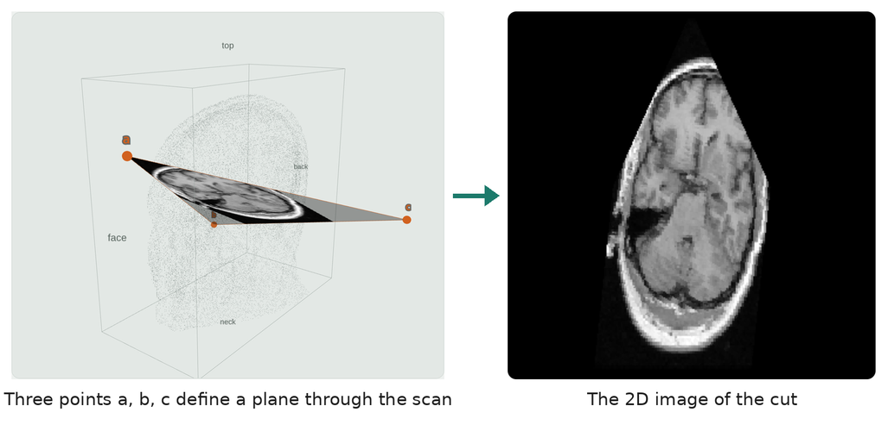
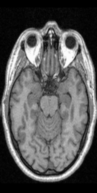
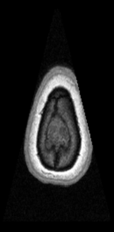
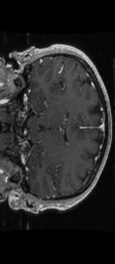

# I2SE_Exe1 – Plane Projection of a 3D Volume

Introduction to Software Engineering - Exercise 1

## The Problem

We are given a 3D volume M (for example an MRI scan) stored as an NRRD file.
M is a 3D matrix of size sx × sy × sz (1 ≤ sx, sy, sz < 1024), where every
entry M[x][y][z] is an unsigned integer value (8, 16 or 32 bits).

We are also given a plane p, defined by:

- 3 points (a, b, c) forming an isosceles triangle: |dist(a,b) − dist(a,c)| < EPS, or
- 4 points (a1, a2, b, c) forming an isosceles trapezoid.

The goal is to compute the 2D image (matrix) of the cut of M along p, at any
angle – similar to the X/Y/Z slice views in 3D Slicer, but for any plane.

Given a list of planes (CSV), the program renders one image per plane and
saves them as a video (MP4).

## Scope

### In scope

- Reading 3D volumes in NRRD format (8/16/32-bit integer voxels).
- Defining a plane by 3 points (triangle) or 4 points (trapezoid), and
  validating it.
- Projecting a plane to a 2D image using the course algorithm.
- Points outside the volume are drawn as 0 (black).
- A demo: `python Ex0.py file.nrrd file.csv file.mp4`.
- Performance: at least 30 FPS on a 500³ volume (target: 100+ FPS).
- Tests and documentation (README, SRS).

### Out of scope

- A graphical user interface (GUI).
- File formats other than NRRD (e.g. DICOM).
- Physical/world coordinates: plane points are given in voxel indices.

## Examples



Each animation below is a demo run: one frame per plane in the CSV file.

<table>
<tr>
<td align="center" width="50%"><br><b>Rotating plane</b><br><code>python Ex0.py data/MRHead.nrrd examples/rotating.csv out.mp4</code></td>
<td align="center" width="50%"><br><b>Sweep from the top of the head to the neck</b><br><code>python Ex0.py data/MRHead.nrrd examples/axial_sweep.csv out.mp4</code></td>
</tr>
<tr>
<td align="center"><br><b>Triangles (3-point planes)</b>: apex at the face<br><code>python Ex0.py data/MRHead.nrrd examples/triangles.csv out.mp4</code></td>
<td align="center"><br><b>Another scan: brain with a tumor</b> (bright spot)<br><code>python Ex0.py data/MRBrainTumor1.nrrd examples/MRBrainTumor1_rotating.csv out.mp4</code></td>
</tr>
</table>

The full-quality videos are in [`results/`](results/). Results for all four scans, the speed measurements and every good and bad demo run are in [docs/EXPERIMENT.md](docs/EXPERIMENT.md).

## How to run

```bash
python3 -m venv .venv && source .venv/bin/activate   # once
pip install -r requirements.txt                       # once (requirements-lock.txt = exact tested versions)
python data/download_data.py MRHead                   # get a real scan

python Ex0.py data/MRHead.nrrd examples/rotating.csv out.mp4   # the demo
python -m pytest                                               # all tests
python benchmarks/bench.py                                     # speed (500^3)
bash run_demo_cases.sh                                         # every good and bad demo run
```

Example plane lists for MRHead are in `examples/` (`axial_sweep.csv`,
`rotating.csv`, `triangles.csv`); `examples/make_planes.py` creates them.

## Project layout

```
projection/   plane.py (plane validation) · projector.py (the algorithm) · io.py (files)
Ex0.py        the demo
tests/        automated tests (pytest), named after the test cases in docs/TESTING.md
benchmarks/   speed test
examples/     plane lists (CSV)
data/         data set: download script + synthetic volumes
docs/         SRS, design, algorithm, testing strategy, experiment
results/      demo output videos
```

## Documents

- [Software Requirements Specification (SRS)](docs/SRS.md)
- [Software design (classes, responsibilities, decisions)](docs/DESIGN.md)
- [Algorithm](docs/ALGORITHM.md)
- [Data set](data/README.md)
- [Testing strategy](docs/TESTING.md)
- [Experiment and results](docs/EXPERIMENT.md)
- [Demo runs: good, edge and bad cases](docs/DEMO_RUNS.md)
