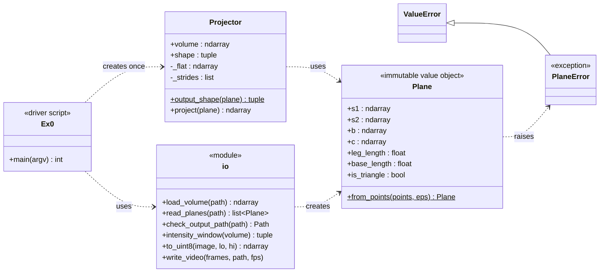

# Software Design

This document describes **how the code is organised**: the classes and
modules, what each one is responsible for, how they work together, and the
design decisions we made (with the alternatives we rejected).
The *what* is in the [SRS](SRS.md); the *math* is in [ALGORITHM.md](ALGORITHM.md).

---

## 1. Overview

The program is a pipeline of three steps. Each step lives in its own module,
and each module knows only about the step before it:

```
  file.nrrd ──► io.load_volume ──► numpy array ──┐
                                                  ├──► Projector.project(plane) ──► image ──► io.write_video ──► file.mp4
  file.csv  ──► io.read_planes ──► [Plane, ...] ─┘
                       │
                       └── Plane.from_points  (validation)
```

`Ex0.py` is only the **driver**: it reads the command line, calls the three
steps in order, and turns every error into one message and exit code.

---

## 2. Class diagram



`s1`/`s2` are the starts of the left and right legs (`a` for a triangle, `a1`/`a2` for a trapezoid).

---

## 3. Responsibilities

| Unit | Responsibility (one each) | Knows about | Does **not** know about |
| --- | --- | --- | --- |
| `Plane` (`plane.py`) | Hold a valid plane, and decide what "valid" means (FR-4, FR-5, FR-12). | NumPy | Files, volumes, images |
| `PlaneError` | Say *which* rule a plane breaks. | – | Line numbers (added by `io`) |
| `Projector` (`projector.py`) | Turn one plane into one image for one volume (FR-7, FR-8). | `Plane`, the volume | Files, CSV, video, brightness |
| `io.py` | Everything about file formats: NRRD in, CSV in, MP4/PNG out, brightness scale for display (FR-1, FR-9–FR-11, FR-13). | `Plane` | How the projection works |
| `Ex0.py` | Command line, order of the steps, error → message + exit code. | All of the above | Any algorithm details |

Because of this split, each part is tested on its own (see
[TESTING.md](TESTING.md)): `Plane` without any volume, `Projector` with
arrays built in the test (no files), `io` with small files, and `Ex0.py`
end to end.

---

## 4. Design decisions

### 4.1 `Plane` is an immutable value object with a factory method

`Plane` is a frozen `dataclass`. User input goes through the factory method
`Plane.from_points(...)` (3 or 4 points, or 9 / 12 numbers). The validation
itself runs in `__post_init__`, so calling `Plane(s1, s2, b, c)` directly is
checked exactly the same way. How the "valid and unchangeable" promise is kept:

| Risk | How it is prevented | Test |
| --- | --- | --- |
| Creating a plane without validation | Validation runs in `__post_init__`, for every way of creating one | TC-P14 |
| Replacing a point (`plane.b = ...`) | `frozen=True`: raises `FrozenInstanceError` | TC-P14 |
| Changing a point in place (`plane.b[0] = ...`) | The points are stored in **read-only** NumPy arrays | TC-P14 |
| The caller changes its own array afterwards | The points are **copied** when the plane is created | TC-P14 |

Being a value object, two planes with the same points are equal (`==`) and
have the same `hash`, so planes can be compared and put in sets or dict keys.

- **Why:** *"if you hold a `Plane`, it is valid."* No other code has to
  check it again, and it cannot be changed into an invalid one later.
- **Alternative rejected:** a plain list of 9/12 numbers passed around, with
  checks inside the projector. That mixes two jobs (validation and
  projection) and the checks would run again for every frame.

### 4.2 One representation for both triangle and trapezoid

Both shapes are stored as two legs `s1→b` and `s2→c`; for a triangle
`s1 = s2 = a`.

- **Why:** the projection code has **one** path for both shapes, with no
  `if triangle … else …`. Fewer branches → fewer bugs, and one set of tests
  covers both (ALGORITHM.md §6).
- **Alternative rejected:** two subclasses `Triangle(Plane)` and
  `Trapezoid(Plane)`, each with its own `project()`. It looks more "OO", but
  the two would contain the same algorithm twice. Polymorphism is useful when
  behaviour *differs*; here only the validation differs, and that is already
  isolated in `_check_triangle` / `_check_trapezoid`.

### 4.3 `Projector` is a class that holds the volume

- **Why:** a video has many planes and one volume. The set-up work (checking
  the volume, making it C-contiguous, computing strides) is done **once** in
  the constructor; `project()` is then called once per frame. This is part of
  how NFR-1 (speed) is met.
- The function `project(volume, plane)` is kept as a one-line convenience for
  scripts and tests that need a single image.
- **Alternative rejected:** a free function `project(volume, plane)` only;
  it would repeat the set-up for every frame.

### 4.4 `io.py` is a module of functions, not classes

The file functions have no state to keep between calls, so they are plain
functions. A `CsvPlaneReader` or `VideoWriter` class would add code without
adding any behaviour.

### 4.5 Errors: one exception type per layer, one exit point

| Layer | Raises | Message contains |
| --- | --- | --- |
| `Plane` | `PlaneError` (a `ValueError`) | the rule that is broken |
| `io.read_planes` | `ValueError` | file name + **line number** + the rule |
| `io.load_volume`, `check_output_path` | `FileNotFoundError`, `ValueError` | file name + reason |
| `Projector` | `ValueError` | what is wrong with the volume |
| `Ex0.main` | – (catches all of the above) | prints `error: …`, returns exit code 2 |

So the core code never prints or exits (it can be used as a library, SRS 2.1
"Developer"), and the user never sees a Python traceback (NFR-3).

### 4.6 Validate everything before doing any work

`Ex0.py` first checks the output path, loads the volume and parses **all**
planes, and only then starts projecting and writing. A bad line 87 is found
in milliseconds, not after 86 frames were already rendered, and a bad input
never leaves a half-written video (FR-13).

### 4.7 Display is separate from the algorithm

`Projector.project` returns the **raw voxel values** in the volume's own type
(uint16, int32, …). Turning them into 0–255 grey levels (`intensity_window`,
`to_uint8`) happens in `io`, only for the video. The algorithm can be tested
exactly (TC-J1, TC-J2 compare values one by one) and reused by code that needs
the real values.

---

## 5. How the design can be extended

| Future change ([EXPERIMENT.md](EXPERIMENT.md) §6) | Where it goes | What else changes |
| --- | --- | --- |
| Trilinear interpolation instead of nearest voxel | A new sampling step inside `Projector` (e.g. a `sampling="nearest" \| "linear"` argument) | Nothing outside `projector.py` |
| Millimetre coordinates (voxel spacing) | `io.load_volume` also returns the spacing; points are converted to voxel units before `Plane.from_points` | `Plane` and `Projector` unchanged |
| CT windows (`--window LOW,HIGH`) | `Ex0.py` argument → `to_uint8(lo, hi)` | Nothing in the core |
| Other input formats (DICOM) | A new `load_…` function in `io.py` that returns the same array | Nothing else |

Each change touches one module, which is the main goal of the split in §3.
