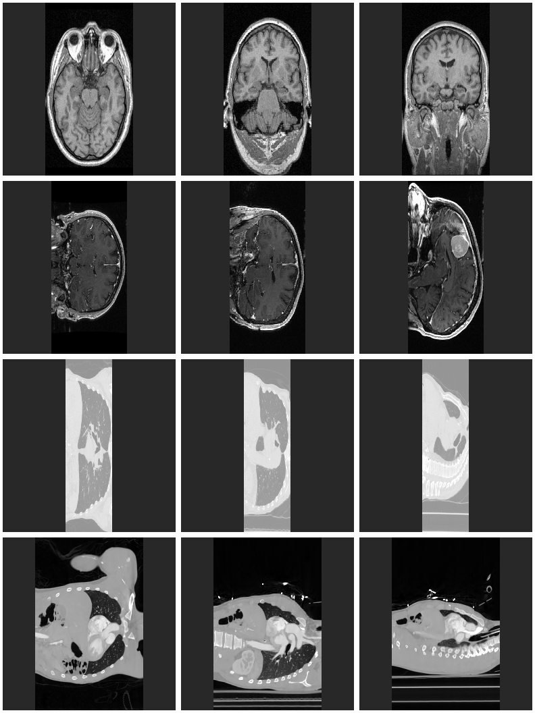

# Experiment and Results

This is step 8 of the assignment: run the demo on the data set, measure it,
and describe what we see.

**Short answer:** the demo works on all 4 real scans and on every edge case
we tried. It rejects all 16 kinds of bad input with a clear message, without
creating a video. It runs at **196 planes per second** on a 500³ volume with
oblique planes, so the required 30 is met with a wide margin and the target
of 100 is met too. One weakness showed up: the automatic brightness window
gives low contrast on CT scans.

---

## 1. Setup

| | |
| --- | --- |
| Machine | Apple Mac (arm64), running the project inside Linux; Python 3.10.12, NumPy 2.2.6 |
| Data | The 4 real scans and the 500³ random volume from the [data set](../data/README.md) |
| Code | Commit after step 6 (algorithm, demo, 59 passing tests). Re-checked after the review fixes (SRS v0.2): 79 passing tests, speed unchanged within measurement noise (185–200 planes per second in `bench.py`). |

How to repeat everything:

```bash
python data/download_data.py              # the 4 real scans
python experiments/run_experiment.py      # sections 2 and 3: videos, sample frames, speed table
python benchmarks/bench.py                # section 2: the 500^3 speed test (TC-F1)
bash run_demo_cases.sh                    # section 4: good, edge and bad demo runs
python -m pytest                          # all automated tests
```

---

## 2. Speed (NFR-1, TC-F1, TC-F2)

Projection only (no file reading or video writing), 100 planes per volume:

| Volume | Size | Type | Frame (rows × cols) | Planes per second |
| --- | --- | --- | --- | --- |
| **random 500³, oblique planes** (`bench.py`, TC-F1) | 500×500×500 | uint8 | 500 × 501 | **196** |
| random 500³, planes turning around one axis | 500×500×500 | uint8 | 500 × 500 | 542 |
| CTACardio (TC-F2) | 512×512×321 | int16 | 512 × 321 | 794 |
| CTChest | 512×512×139 | int32 | 512 × 139 | 1,619 |
| MRHead | 256×256×130 | int16 | 256 × 130 | 3,282 |
| MRBrainTumor1 | 256×256×112 | int16 | 256 × 112 | 3,819 |

**Requirement:** at least 30 per second, target 100. **Result: met on every volume.**

Observations:
- Speed depends mostly on the number of pixels in a frame: MRHead frames are
  about 7 times smaller than the 500³ frames and are projected about 17 times faster.
- Oblique planes (`bench.py` tilts every plane) are about 2.8× slower than
  planes that turn around one axis, on the same volume and frame size. The
  likely reason is memory access: an oblique plane reads voxels that lie far
  apart in memory. We report the slower number as the official result.
- Reading the file and writing the video take longer than the projection itself.
  For example, the whole demo on CTACardio (90 planes) takes about 2.0 s, of
  which the 90 projections take 0.13 s. The projection is not the bottleneck.

---

## 3. What the videos show

For each scan, `run_experiment.py` renders 90 rectangles through the centre,
turning half a turn (`results/<scan>_rotating.mp4`). The image below shows 3 frames
of each video: the start, a quarter of the turn and half of the turn.



*Rows from top: MRHead, MRBrainTumor1, CTChest, CTACardio.*

| Scan | What we see | Correct? |
| --- | --- | --- |
| MRHead | Horizontal cut with eyes, nose and brain, then turning into a front view of the brain and neck | Yes: same anatomy as 3D Slicer's views |
| MRBrainTumor1 | The tumor (bright round spot) appears in the last frame | Yes |
| CTChest | Lungs (grey) and body (light), ribs at the edge | Yes, but **low contrast** and very **narrow** (see below) |
| CTACardio | Heart and vessels filled with contrast agent, spine, ribs | Yes |

### Findings

1. **Narrow images (expected).** Every image is squeezed along the 3rd axis.
   This is because the plane works in voxel indices, and in these scans the
   voxels are longer along that axis. We chose this on purpose (README, "Out of
   scope"). The size of the effect is the ratio of the voxel sides:

   | Scan | Voxel size (mm) | Squeeze factor |
   | --- | --- | --- |
   | MRHead | 1 × 1 × 1.3 | 1.3 |
   | CTACardio | 0.93 × 0.93 × 1.25 | 1.34 |
   | MRBrainTumor1 | 0.94 × 0.94 × 1.4 | 1.5 |
   | CTChest | 0.76 × 0.76 × 2.5 | **3.3** |

   CTChest is the clearest example. Supporting millimetre coordinates would fix it ([section 6](#6-limitations-and-future-work)).

2. **Low contrast on CT (a real weakness).** The brightness window is taken
   automatically from the 0.5–99.5 percentiles of the whole volume (FR-11). On
   MRI this works well. On CT the values range from air (−1000) to bone
   (+1000 and more), so soft tissue ends up in a narrow band of greys.
   Radiologists use fixed "windows" for CT, for example lungs or soft tissue.
   A `--window LOW,HIGH` option would fix this ([section 6](#6-limitations-and-future-work)).

3. **Grey border in CTChest.** The scanner fills the area outside its round
   field of view with a constant value. That area is part of the file, so it
   shows as grey, not black. This is correct behaviour.

---

## 4. Demo runs: good, edge and bad (TC-D, FR-6, NFR-3)

`run_demo_cases.sh` runs the demo 24 times. The full output is in
[DEMO_RUNS.md](DEMO_RUNS.md). Summary:

**Good runs: exit code 0, video created**

| Case | Input | Result |
| --- | --- | --- |
| G1 | MRHead + `rotating.csv` (90 rectangles) | 90 frames |
| G2 | MRHead + `axial_sweep.csv` (120 rectangles) | 120 frames |
| G3 | MRHead + `triangles.csv` (40 triangles) | 40 frames |
| G4 | `--png-dir` | video + 2 PNG files |
| G5 | `--help` | usage text |

**Edge cases: valid input with an unusual result, exit code 0**

| Case | Input | Result |
| --- | --- | --- |
| E1 | A triangle and a rectangle in one CSV | 2 frames of different shapes, centred in the video |
| E2 | Rectangle half outside the scan | The outside half is black |
| E3 | Rectangle completely outside the scan | One all-black frame. No warning is printed ([section 6](#6-limitations-and-future-work)) |

**Bad input: exit code 2, error message, no video created**

| Case | Input | Message |
| --- | --- | --- |
| B1 | Legs not equal | `line 3: legs differ in length: 263.0309 vs 264.5170 (EPS = 0.001)` |
| B2 | 3 points on one line | `line 2: a, b, c are collinear (on one line), so they do not define a plane` |
| B3 | 4 points not on one plane | `line 2: the four points are not on the same plane` |
| B4 | Trapezoid top wider than base | `line 2: dist(a1, a2) must be <= dist(b, c)` |
| B5 | 7 numbers in a line | `line 2: expected 9 or 12 numbers, got 7` |
| B6 | A word instead of a number | `line 3: not a number: abc` |
| B7 | CSV with no planes | `no planes found` |
| B8 | NRRD file missing | `data/missing.nrrd: file not found` |
| B9 | CSV file missing | `examples/missing.csv: file not found` |
| B10 | A file that is not NRRD | `README.md: not a valid NRRD file (...)` |
| B11 | Missing arguments | `usage: ...  error: the following arguments are required: csv, mp4` |
| B12 | Plane with legs of 100,000 voxels | `line 2: plane too large: legs are 100000.0 voxels long (max 4096)` |
| B13 | Typo in the first plane (`129x`) | `line 2: not a number: 129x` (not skipped as a header) |
| B14 | 4 points whose legs cross | `line 2: the legs cross: a1 must be on the side of b, and a2 on the side of c` |
| B15 | Output folder does not exist | `no_such_folder/out.mp4: output folder no_such_folder does not exist` |
| B16 | `--fps 0` | `argument --fps: must be a positive whole number, got 0` |

In all 16 bad cases no MP4 file was created, and no case shows a Python traceback. The demo checks all input before
it writes anything.

---

## 5. Conclusions

- The algorithm from [ALGORITHM.md](ALGORITHM.md) is correct on real data. The
  anatomy is where it should be, at every angle.
- The speed requirement is met with a wide margin: 196 per second in the worst
  case against the required 30. The "pull" approach, with all pixels computed at
  once in NumPy, is what makes this possible in Python.
- The demo is robust. Every bad input we tried gives a clear message that
  names the file, the line and the rule that was broken.

## 6. Limitations and future work

| Limitation | Seen in | Possible fix |
| --- | --- | --- |
| Images squeezed when voxels are not cubes | [Section 3](#3-what-the-videos-show), finding 1 (CTChest: 3.3×) | Use the voxel spacing from the NRRD header (millimetre coordinates) |
| Low contrast on CT | [Section 3](#3-what-the-videos-show), finding 2 | `--window LOW,HIGH` option with presets (lungs, soft tissue, bone) |
| Plane completely outside the scan gives a black frame, silently | [Section 4](#4-demo-runs-good-edge-and-bad-tc-d-fr-6-nfr-3), E3 | Print a warning with the CSV line number |
| Nearest-voxel sampling looks blocky when zoomed | close-up of frames | Trilinear interpolation (slower) |
